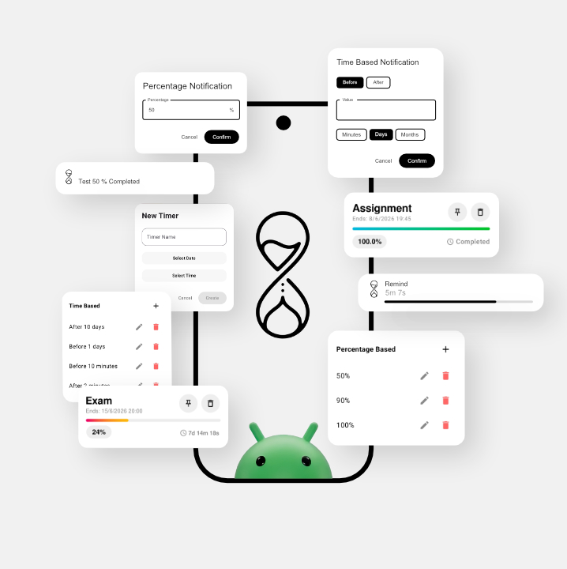

  

# Remind

I used to forget my things so I built this app. Whether it's a deadline, an appointment, or just a reminder to take a break, Remind helps you keep track of your time with a beautiful and intuitive interface.

## ✨ Features

- **Personalized Timers**: Create custom timers with specific names and end dates/times. Perfect for tracking long-term deadlines or short-term tasks.
- **Visual Progress Tracking**: Every timer features a dynamic gradient progress bar and a live percentage indicator. The colors shift from a vibrant Pink-to-Yellow while active to a calming Blue-to-Green once completed.
- **Intelligent Sorting & Pinning**: Keep your most important tasks at the top. You can pin specific timers to ensure they are always visible, and the app automatically organizes the rest by urgency.
- **Customizable Milestone Notifications**: Unlike standard timers, Remind lets you decide when you want to be notified.
    - **Percentage-Based**: Get alerted when a certain percentage of your time has passed (e.g., at 50% or 75%).
    - **Time-Based**: Set alerts for specific intervals before or after your timer ends (e.g., 1 day before or 2 hours after).
- **Home Screen Widgets**: Stay updated without even opening the app. The glassmorphism-style widget provides live updates and adapts its layout based on the size you choose on your home screen.
- **Pinned System Notifications**: "Pin" a timer to your notification tray for a live, ongoing countdown that you can check at any time.
- **In-App Updates**: Stay on the latest version with a built-in update system that notifies you of new features and downloads them seamlessly within the app.

## 🛠️ Technologies Used

- **Kotlin**: The primary programming language for modern Android development.
- **Jetpack Compose**: Used to build a fully reactive and modern declarative UI.
- **Material 3**: Implementation of Google's latest design system for a consistent and beautiful look.
- **Android Glance**: For building responsive and interactive home screen widgets.
- **Kotlin Coroutines & Flow**: Handles asynchronous tasks and real-time data updates across the app.
- **DataStore & Kotlinx Serialization**: Ensures your timers and settings are stored safely and persist across reboots.
- **ViewModel & StateFlow**: Follows the MVVM architecture to ensure a robust and maintainable codebase.
- **Notification Manager & Services**: Manages background alerts and live system notifications.

---
Built with ❤️ to help you never forget what matters.
